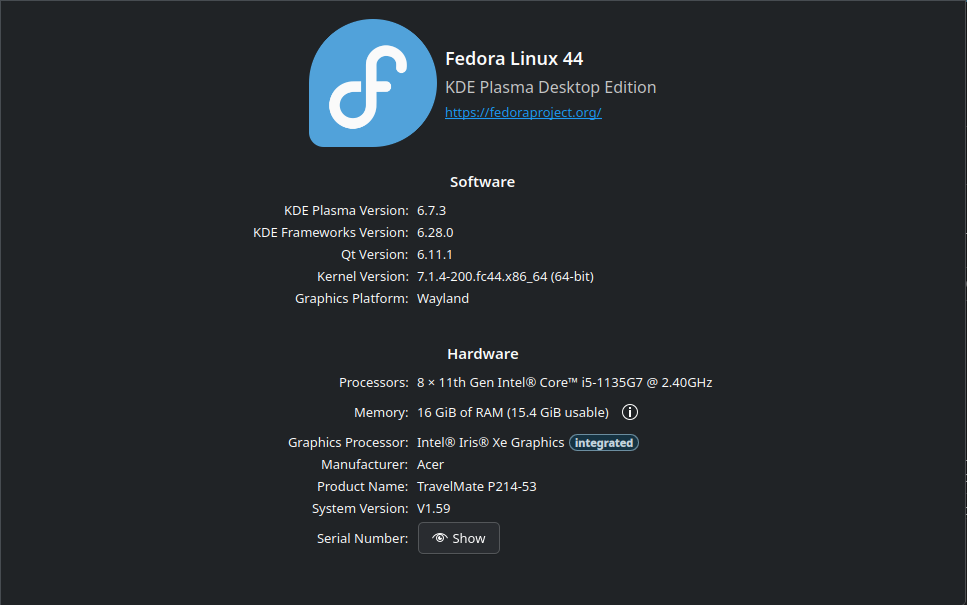
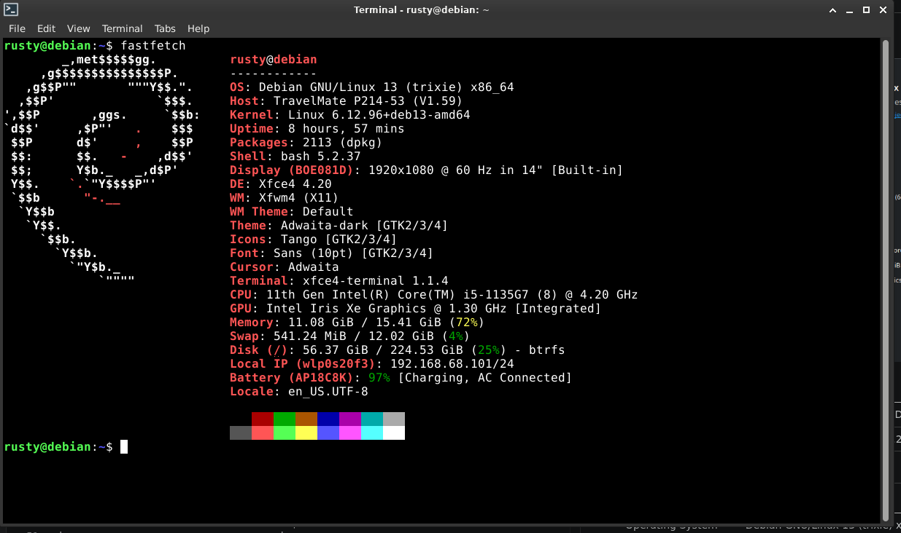
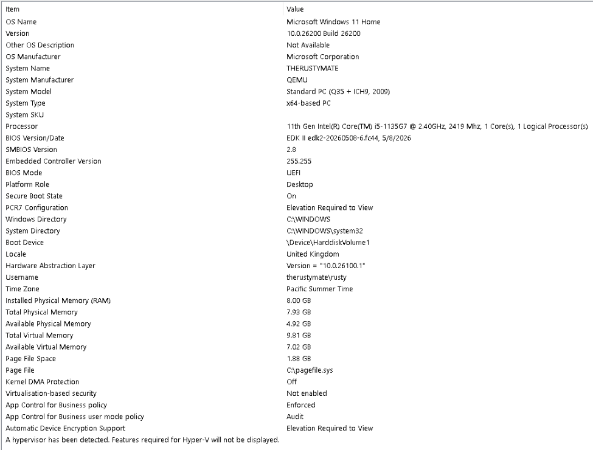
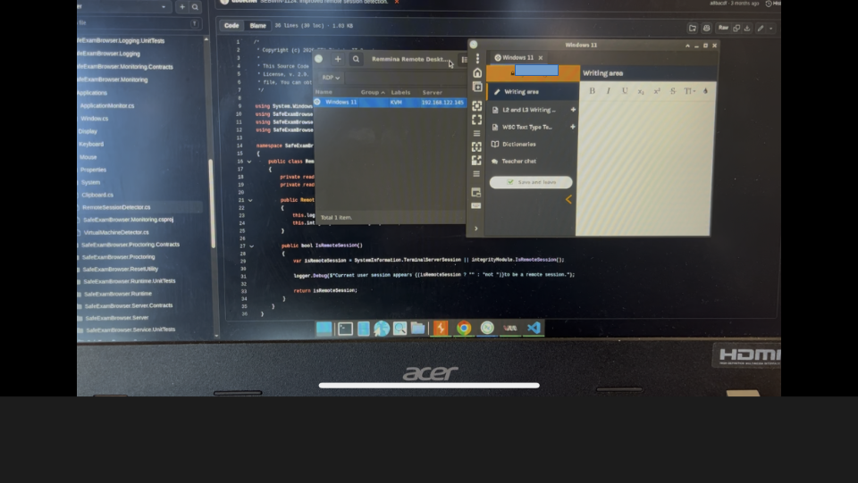
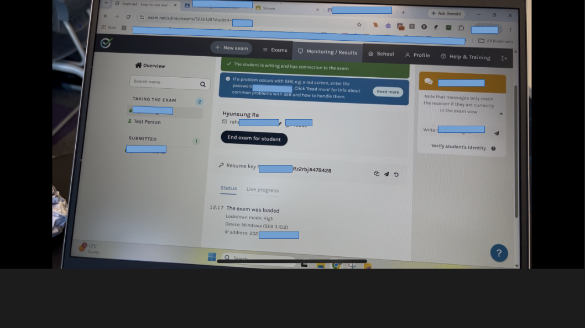
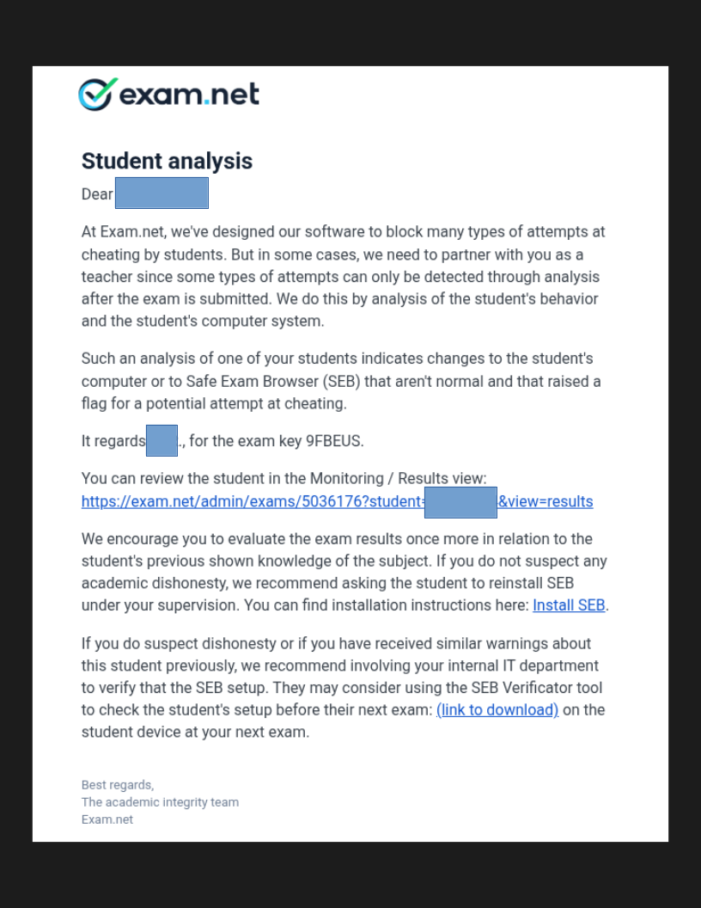

# EVirt_SEB
Safe Exam Browser VM Detection Bypass Research

## Disclaimer
This project and all associated materials are provided strictly for authorized penetration testing for college environments and educational and research purposes only.

This project declares that it is NOT intended to encourage cheating on online exams.

## Executive Summary
Project EVirt_SEB is a VM detection bypass research project for Safe Exam Browser (or SEB) through static and dynamic reverse engineering, ultimately to propose mitigations against identified vulnerabilities.

## Purpose
The ultimate goal of this project is to identify potential VM detection bypass-related vulnerabilities through static and dynamic reverse engineering and propose possible mitigations against identified vulnerabilities.

## Scope
The scope of this project covers [Windows Safe Exam Browser v3.10.2](https://github.com/SafeExamBrowser/seb-win-refactoring/releases/tag/v3.10.2) and will be tested on the following operating systems:

* KVM/QEMU 10.2.2
    * Windows 11 10.0.26200 Build 26200

## Out Of Scope
* MacOS Safe Exam Browser
* Exam.net
* LMS

## Tools & Environment

### Testing Environment

| Environment           | Information                                       |
|:----------------------|:--------------------------------------------------|
| Operating System      | Fedora Linux 44 KDE Plasma Desktop Edition        |
| Virtualization Engine | QEMU emulator version 10.2.2 (qemu-10.2.2-1.fc44) |
| Architecture          | Intel x64                                         |

---

| Environment           | Information                                       |
|:----------------------|:--------------------------------------------------|
| Operating System      | Debian GNU/Linux 13 (trixie) x86_64               |
| Virtualization Engine | QEMU emulator version 10.0.11 (qemu-10.2.2-1.fc44)|
| Architecture          | Intel x64                                         |

---

| Item                              | Value                                 |
|:----------------------------------|:--------------------------------------|
| **OS**                            | Microsoft Windows 11 Home             |
| **OS Version**                    | 10.0.26200 Build 26200                |
| **OS Manufacturer**               | Microsoft Corporation                 |
| **System Name**                   | THERUSTYMATE                          |
| **System Manufacturer**           | QEMU                                  |
| **System Model**                  | Standard PC (Q35 + ICH9, 2009)        |
| **System Type**                   | x64-based PC                          |
| **Processor**                     | 11th Gen Intel(R) Core(TM) i5-1135G7  |
| **BIOS Version**                  | EDK II edk2-20260508-6.fc44, 5/8/2026 |
| **SMBIOS Version**                | 2.8                                   |
| **BIOS Mode**                     | UEFI                                  |
| **Platform Role**                 | Desktop                               |
| **Secure Boot State**             | On                                    |
| **Installed Physical Memory**     | 8.00 GB                               |
| **Kernel DMA Protection**         | Off                                   |
| **Virtualization-based Security** | Not enabled                           |
| **Hypervisor Bit**                | Detected                              |

---

| Item                              | Value                                             |
|:----------------------------------|:--------------------------------------------------|
| **OS**                            | Microsoft Windows 11 Pro                          |
| **OS Version**                    | 10.0.26200 Build 26200                            |
| **OS Manufacturer**               | Microsoft Corporation                             |
| **System Name**                   | DESKTOP-1L5BAXH                                   |
| **System Manufacturer**           | QEMU                                              |
| **System Model**                  | Standard PC (Q35 + ICH9, 2009)                    |
| **System Type**                   | x64-based PC                                      |
| **Processor**                     | 11th Gen Intel(R) Core(TM) i5-1135G7              |
| **BIOS Version**                  | Debian distribution of EDK II 2025.02-8+deb13u1   |
| **SMBIOS Version**                | 2.8                                               |
| **BIOS Mode**                     | UEFI                                              |
| **Platform Role**                 | Desktop                                           |
| **Secure Boot State**             | On                                                |
| **Installed Physical Memory**     | 8.00 GB                                           |
| **Kernel DMA Protection**         | Off                                               |
| **Virtualization-based Security** | Not enabled                                       |
| **Hypervisor Bit**                | Detected                                          |

*Note: this information will be changed as new VM settings applies.*

## Methodology

### Fundamental Concepts & Definitions

* [**Virtual Machine (VM)**](https://azure.microsoft.com/en-us/resources/cloud-computing-dictionary/what-is-a-virtual-machine): A virtual machine emulates a physical computer, running its own operating system and apps with virtualized resources. It’s isolated from the host system, allowing users to perform secure tasks like testing apps or using different operating systems while optimizing physical hardware.
* [**Windows Registry**](https://learn.microsoft.com/en-us/troubleshoot/windows-server/performance/windows-registry-advanced-users): A central hierarchical database used in Windows 98, Windows CE, Windows NT, and Windows 2000 used to store information that is necessary to configure the system for one or more users, applications, and hardware devices.
* [**Windows Management Instrumentation (WMI)**](https://learn.microsoft.com/en-us/windows/win32/wmisdk/wmi-start-page): Windows Management Instrumentation (WMI) is the infrastructure for management data and operations on Windows-based operating systems. Although you can write WMI scripts or applications to automate administrative tasks on remote computers, WMI also supplies management data to other parts of the operating system and products.

---

* **SEB**: Safe Exam Browser

### Techniques & Strategies
**SEB VM detection techniques are based on Windows Registry, WMI, CPUID, Hardware Enumeration, Driver Enumeration**. As spoofing these components are possible, **it is possible to decrease the VM detection confidence by spoofing the system components above, resulting possible VM detection bypass**.

### Validation Method
A test exam with high security mode (Safe Exam Browser) will be provided through the [Exam.net](https://exam.net/) from an exam supervisor and the research outcome (exploit) will be tested on the exam to simulate an online exam security bypass scenario.

### Validation Standards
1. SEB fails to detect VM and remote session and shows missing configuration screen.
2. SEB fails to detect VM and remote session and allows the researcher to take a test exam.
3. The supervisor cannot notice any visual difference during the inspection.

### Validation Assumption
1. The latest version of Safe Exam Browser is SEB v3.10.2.
2. The simulated threat actor (a bad student) can customize VM configurations.

## Research
[Reverse Engeering Research](./research/README.md)

The QEMU/KVM configuration XML file is at: [./research/vm_config.xml](./research/vm_config.xml)

### Requirements
The following software were installed during the tests:
* [virtio-win-0.1.285](https://fedorapeople.org/groups/virt/virtio-win/direct-downloads/archive-virtio/virtio-win-0.1.285-1/)

*Note: ISO file was used for the research.*

### Reproduce Instructions
1. Install VirtIO drivers.
2. Use VirtIo video model type in KVM/QEMU.
3. Reboot.
4. Install SafeExamBrowser.
5. Apply EVirtPatch.
6. Manually apply `seb_x64.dll` DLL proxy.

*Note: If the SEB displays internal/external display-related warnings, please modify the VM configuration to use VirtIO drivers for the video model.*

### Patch & Reverse Engineering: `seb_x64.dll`
The DLL `seb_x64.dll` is responssible for:
1. Verifying the code and runtime integrity.
2. Detecting virtual machines (1 out of 7 detection layers).
3. Detecting remote sessions (1 out of 2 detection layers).

When SafeExamBrowser is launched, the module `SafeExamBrowser.Integrity` imports the `seb_x64.dll` and defines the following functions:
* **`bool IsRemoteSession();`**
* **`bool IsVirtualMachine(out IntPtr manufacturer, out int probability);`**
* **`bool VerifyCodeSignature();`**
* **`bool VerifyRuntimeIntegrity(out IntPtr data, out int count);`**
* ...

The functions `VerifyCodeSignature` and `VerifyRuntimeIntegrity` are responssible for verifying the integrity of SafeExamBrowser. However, there are no additional protection layers to confirm its integrity, meaning this can be bypassed if they are manipulated.

DLL proxy execution technique exploits the [DLL search order](https://learn.microsoft.com/en-us/windows/win32/dlls/dynamic-link-library-search-order), resulting the SafeExamBrowser to load the crafted malicious DLL which manipulates the integrity verification results.

The following source codes weaponize the DLL proxy execution technique to manipulate the integrity verification, virtual machine detection, and remote session detection results of the SafeExamBrowser:
* *[seb_x64.c](./seb_x64_patch/seb_x64.c)*
* *[seb_x64.def](./seb_x64_patch/seb_x64.def)*
* *[seb_x64.sh](./seb_x64_patch/seb_x64.sh)*

*To ensure that this project cannot be directly abused to bypass the SafeExamBrowser, the EVirtPatch program does not support automatic DLL proxy execution setup, therefore, bypassing the integrity verification must be done manually. This "may" allow exam supervisors to detect compromised SafeExamBrowser and take actions against them. However, setting up the DLL proxy execution is not complicated and related information are available on online.*

### Patch & Reverse Engineering: `SafeExamBrowser.Monitoring.dll`
The DLL `SafeExamBrowser.Monitoring.dll` is responsible for:
1. Monitoring the clipboard.
2. Detecting virtual machines (6 out of 7 detection layers).
3. Detecting remote sessions (1 out of 2 detection layers).

The function `IsVirtualMachine` detects virtual machines through the following 7 layers of detection layers:
1. System hardware detection (WMI).
2. PnP (Plug aNd Play) device detection.
3. MAC address detection.
4. KVM virtual CPU detection.
5. Device cache detection (Registry).
6. BIOS virtual system detection.
7. `seb_x64!IsVirtualMachine`

The function `IsRemoteSession` detects remote sessions through the following 2 layers of detection layers:
1. Terminal server session detection.
2. `seb_x64!IsRemoteSession`

Instead of attempting to bypass these individual detection layers, patching the DLL to return manipulated detection results leads to a detection bypass. However, patching the program will cause an integrity verification failure, meaning without the previous DLL proxy execution patch, the SafeExamBrowser detects that it self is compromised.

### Conclusion
Using the `SafeExamBrowser.Monitoring.dll` patch, the virtual machine and remote session detection of the SafeExamBrowser was successfully bypassed. However, this patch triggers both the code and runtime integrity verification failure. Furthermore, the 7th layer of the virtual machine detection layers and the 2nd layer of the remote session detection layers can log both the virtual machine detection results and the remote session detection results.

Using the `seb_x64.dll` patch, the integrity verification results were manipulated, leading to a successful integrity verification bypass. The patch also manipulates the external virtual machine and remote session detections (7th layer of virtual machine detection layers & 2nd layer of remote session detection layers), leading to a complete detection bypass.

## Validation
| VM                                | Supervisor                    |
|:----------------------------------|:------------------------------|
|      |  |

Exam.net-based exam environments were accessible through VM after patching SEB with EVirtPatch and new proxy `seb_x64.dll`. However, Exam.net detected unusual changes on SEB and the VM device:

## Limitations
* **Reality**: Realistically students cannot easily configure and control virtual machines to cheat on online exams. This may require knowledges related to virtual machine configurations.
* **Phyiscal Security**: Supervisors can physically monitor students' PC which may detect attemps to cheat on online exams.
* **Exam.net Detection**: After the supervised research, Exam.net sent emails to supervisors who authorised these tests that they detected unusual changes on SEB and the device (it is uncertain that how and what exactly they detected).

## References
ChatGPT, Gemini, and DeepSeek were used to improve the technical English expressions in this document.
* [https://safeexambrowser.org/download_en.html](https://safeexambrowser.org/download_en.html)
* [https://github.com/SafeExamBrowser/seb-win-refactoring/releases/tag/v3.10.2](https://github.com/SafeExamBrowser/seb-win-refactoring/releases/tag/v3.10.2)
* [https://en.wikipedia.org/wiki/Virtual_machine](https://en.wikipedia.org/wiki/Virtual_machine)
* [https://learn.microsoft.com/en-us/windows/win32/wmisdk/wmi-start-page](https://learn.microsoft.com/en-us/windows/win32/wmisdk/wmi-start-page)
* [https://en.wikipedia.org/wiki/Windows_Registry](https://en.wikipedia.org/wiki/Windows_Registry)