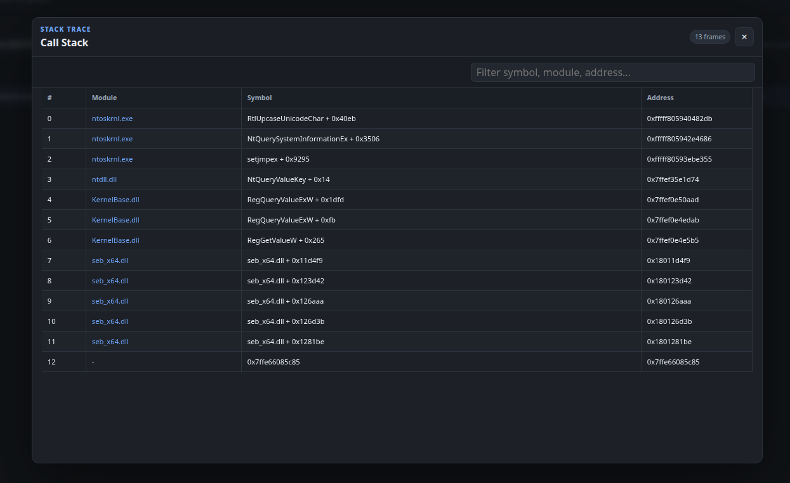
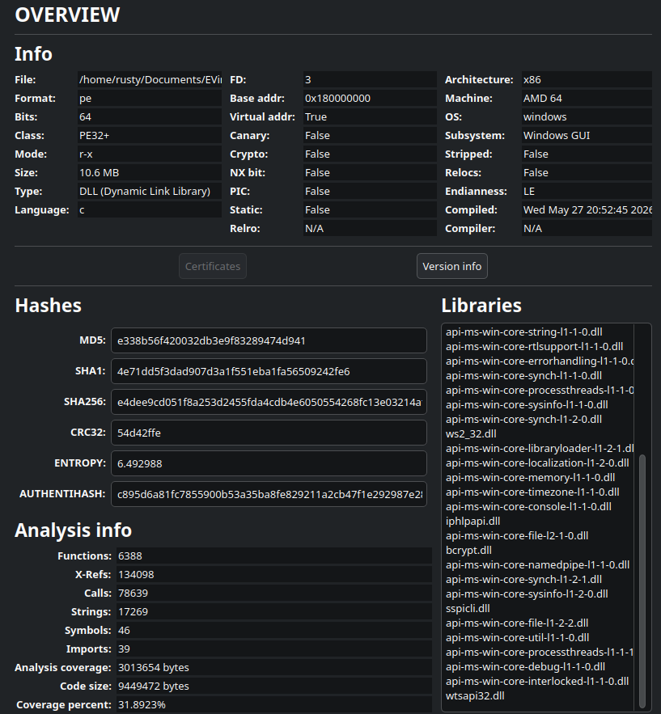
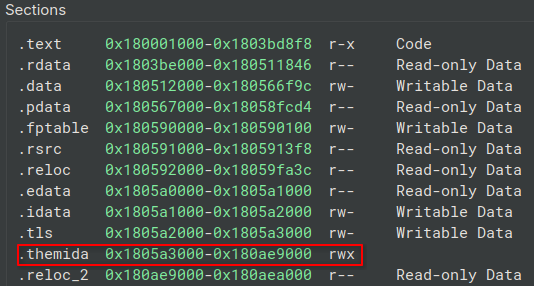
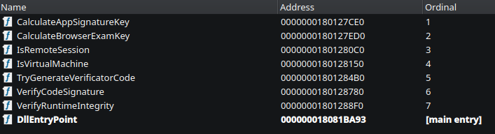
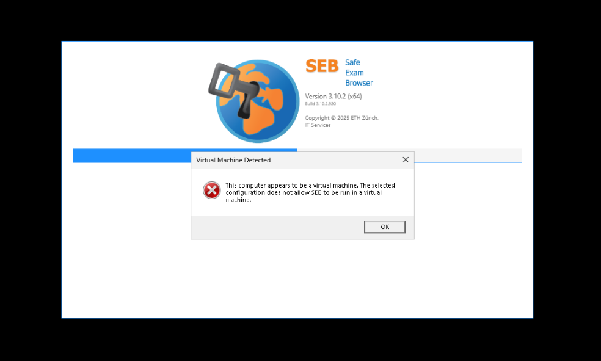
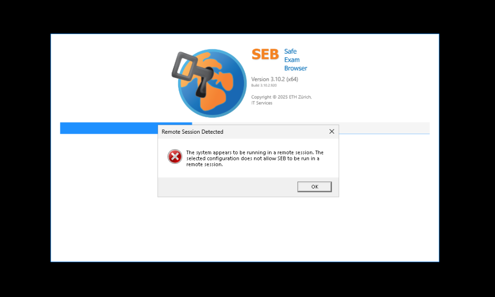
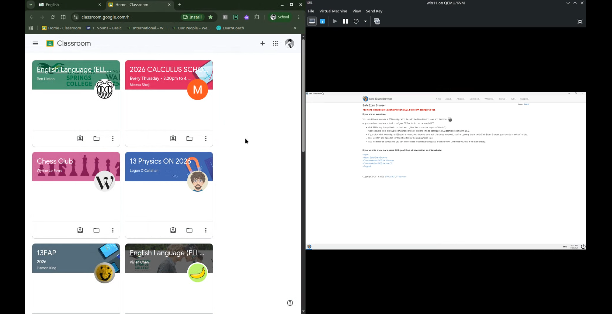

<div align="center">
    <h1>Project EVirt_SEB</h1>
    <h3>Safe Exam Browser VM Detection Bypass Research</h3>
</div>

---


# **Dynamic Reverse Engineering**

## **Process Execution Flow**
1. Initialize startup procedure
    * Load `system language`
2. Start communication host
    * Open a net pipe: `net.pipe://localhost/safeexambrowser/runtime/[UUID]`
3. Verify application and runtime integrity
4. Initialize new session configuration
    * Load `Client-ID`
    * Load `Runtime-ID`
    * Load `Session-ID`
5. Initialize application configuration
6. Validate version restrictions
7. Validate remote session policy
8. Validate session integrity
    * Disable sticky keys
    * Start cursor verification
    * Start ease of access verification
9. **Validate virtual machine policy**
10. Continue OR Exit

The file: *[2026-07-21_20h46m25s_Runtime.log](./dynamic/logs/2026-07-21_20h46m25s_Runtime.log)* suggest that at **20:46:56.551**, the VM validation procedure was started and ended at **20:46:58.012**. Using this information, it is possible to identify which system information SEB queried for VM detection during this procedure. The runtime log can be found in the following folder: `C:\Users\%username%\AppData\Local\SafeExamBrowser\Logs`.


```bash
$ cat 2026-07-21_20h46m25s_Runtime.log | grep "virtual"
2026-07-21 20:46:56.551 [11] - INFO: Validating virtual machine policy...
2026-07-21 20:46:57.996 [11] - DEBUG: [VirtualMachineDetector] Computer 'THERUSTYMATE' appears to be a virtual machine (QEMU, 100%).
2026-07-21 20:46:58.012 [11] - ERROR: Detected virtual machine while SEB is not allowed to be run in a virtual machine! Aborting...
```

[ProcMon (Process Monitor)](https://learn.microsoft.com/en-us/sysinternals/downloads/procmon) can show which Windows Registry, File, SEB accessed during this time.

Searching the file: *[ProcMon_SEB.csv](./dynamic/dumps/ProcMon_SEB.csv)* will provide potential information essential to identifying system information SEB queried for VM detection:

```bash
$ cat ProcMon_SEB.csv | grep ".531"
"8:46:23.9355311 PM","SafeExamBrowser.exe","6960","Load Image","C:\Windows\System32\msvcp_win.dll","SUCCESS","Image Base: 0x7ffef0010000, Image Size: 0xa3000"
```

Using the `grep` search command: `cat ProcMon_SEB.csv | grep -E "^......56|^......57|^......58"`

```bash
$ cat ProcMon_SEB.csv | grep -E "^......56|^......57|^......58"
...
"8:46:56.9634035 PM","SafeExamBrowser.exe","6960","RegOpenKey","HKLM\System\CurrentControlSet\Enum\SWD\MMDEVAPI\MICROSOFTGSWAVETABLESYNTH","SUCCESS","Desired Access: Query Value, Maximum Allowed"
"8:46:56.9634116 PM","SafeExamBrowser.exe","6960","RegQueryValue","HKLM\System\CurrentControlSet\Enum\SWD\MMDEVAPI\MicrosoftGSWavetableSynth\HardwareID","NAME NOT FOUND","Length: 4,108"
"8:46:56.9634185 PM","SafeExamBrowser.exe","6960","RegCloseKey","HKLM\System\CurrentControlSet\Enum\SWD\MMDEVAPI\MicrosoftGSWavetableSynth","SUCCESS",""
...
```

Redirecting this output to a new modified .CSV file: *[ProcMon_SEB_modified01.csv](./dynamic/outputs/ProcMon_SEB_modified01.csv)* will allow us to inspect which system information SEB queried for VM detection with less noises.

Using the `grep` output redirection command: 

```bash
cat ProcMon_SEB.csv | grep -E "^......56|^......57|^......58" > ../outputs/ProcMon_SEB_modified01.csv
```

After removing extra data included before **20:46:56.551** and after **20:46:58.012**, it is possible to see the system information SEB queried: *[ProcMon_SEB_modified02.csv](./dynamic/outputs/ProcMon_SEB_modified02.csv)*

The custom python script: *[procmon_csv_parser.py](../test/procmon_csv_parser.py)* can parse the ProcMon CSV file and list unique items on selected columns.

```bash
$ python3 procmon_csv_parser.py -c 5 -f ../research/dynamic/outputs/ProcMon_SEB_modified02.csv
...
HKLM\System\CurrentControlSet\Services\Tcpip\Parameters
HKLM\System\CurrentControlSet\Services\Tcpip\Parameters\Domain
HKLM\System\CurrentControlSet\Services\Tcpip\Parameters\Hostname
...
```

Using the custom python script output redirection command:

```bash
$ python3 procmon_csv_parser.py -c 5 -f ../research/dynamic/outputs/ProcMon_SEB_modified02.csv > ../research/dynamic/outputs/unique_queried_sys_info_items.txt
```

*--- Ended at 2026-07-21 11:28 PM NZD ---*

The file: *[unique_queried_sys_info_items.txt](./dynamic/outputs/unique_queried_sys_info_items.txt)* is the unique items of the system information SEB queried. One of the Windows Registry that SEB queried was `HKLM\HARDWARE\DESCRIPTION\System\BIOS\SystemManufacturer` which is mainly used for VM detection.

*Note: still several noises can be found*

Using [ProcMonParser](https://therustymate.com/ProcMonParser) (browser-based ProcMon .XML parser), it is possible to inspect the stack trace that is recorded:




The stack trace suggests that the module `seb_x64.dll` have queried the Windows Registry key.

# **Static Reverse Engineering**



```bash
$ file seb_x64.dll
seb_x64.dll: PE32+ executable for MS Windows 6.00 (DLL), x86-64, 12 sections
```

The module `seb_x64.dll` is protected with the [Themida Protector](https://www.oreans.com/Themida.php).



Inspecting the EAT (Export Address Table) allows us to identify the entry point of VM detection function: `IsVirtualMachine`



This function is called from the file: *[seb-win-refactoring/SafeExamBrowser.Integrity
/IntegrityModule.cs](https://github.com/SafeExamBrowser/seb-win-refactoring/blob/7afddaa03087b7d47f55a123b60b0a62c4b9d42e/SafeExamBrowser.Integrity/IntegrityModule.cs#L97)*. 

```cs
public bool IsVirtualMachine(out string manufacturer, out int probability)
{
    var isVirtualMachine = false;

    manufacturer = default;
    probability = default;

    try
    {
        isVirtualMachine = Native.IsVirtualMachine(out var bstr, out probability);

        if (bstr != IntPtr.Zero)
        {
            manufacturer = Marshal.PtrToStringBSTR(bstr);
            Marshal.FreeBSTR(bstr);
        }
    }
    catch (DllNotFoundException)
    {
        logger.Warn("Integrity module is not available!");
    }
    catch (Exception e)
    {
        logger.Error("Unexpected error while attempting to query virtual machine information!", e);
    }

    return isVirtualMachine;
}
```

The function signature of `seb_x64.dll!IsVirtualMachine` is:
```c
extern "C" bool __cdecl IsVirtualMachine(
    BSTR* manufacturer,
    int* probability
);
```

The function `IsVirtualMachine` detects the following virtualization software:
* Hyper-V
* KVM
* QEMU
* VMware
* VirtualBox


---

After reverse engineering, the recovered code of the function `IsVirtualMachine` is this:
```c
char IsVirtualMachine(BSTR *manufacturer,int *probability)

{
    char codeSignatureValid;
    byte vmProbability;
    undefined4 randomSeed;
    uint randomValue;
    int randomVendorValue;
    VmContext *vmContext;
    BSTR manufacturerBstr;
    VendorList *vendorAllocation;
    MsvcString *manufacturerStringA;
    WString32 *wideManufacturer;
    wchar_t *manufacturerWideBuffer;
    char isVirtualMachine;
    int probabilityValue;
    MsvcString *vendorList;
    MsvcString *selectedVendor;
    VmContext detectionContext;
    VmContext manufacturerContext;
    VmContext probabilityContext;
    WString32 manufacturerString;
    WString32 fallbackManufacturerString;
    MsvcString emptyVendor;
    MsvcString selectedVendorCopy;
    MsvcString manufacturerStorage;
    MsvcString movedVendor;
    
                    /* 0x128150  4  IsVirtualMachine */
    codeSignatureValid = VerifyCodeSignature();
    if (codeSignatureValid == '\0') {
        vendorAllocation = alloc(168);
        if (vendorAllocation == (VendorList *)0x0) {
            vendorList = (MsvcString *)0x0;
        }
        else {
            vendorAllocation->count = 5;
            StringConstruct(vendorAllocation->vendors,"Hyper-V");
            StringConstruct(vendorAllocation->vendors + 1,"KVM");
            StringConstruct(vendorAllocation->vendors + 2,"QEMU");
            StringConstruct(vendorAllocation->vendors + 3,"VMware");
            StringConstruct(vendorAllocation->vendors + 4,"VirtualBox");
            vendorList = vendorAllocation->vendors;
        }
        randomSeed = std_time(0);
        std_srand(randomSeed);
        randomValue = std_rand();
        isVirtualMachine =
             (randomValue & 1 ^ (int)randomValue >> 0x1f) - ((int)randomValue >> 0x1f) == 1;
        if (!(bool)isVirtualMachine) {
            selectedVendor = StringConstruct(&emptyVendor,"");
        }
        else {
            randomVendorValue = std_rand();
            selectedVendor = StringCopy(&selectedVendorCopy,vendorList + randomVendorValue % 5);
        }
        manufacturerStringA = StringMove(&movedVendor,selectedVendor);
        wideManufacturer = ConvertStringToWString(&fallbackManufacturerString,manufacturerStringA);
        manufacturerWideBuffer = WStringData(wideManufacturer);
        manufacturerBstr = (BSTR)(*(code *)0x8000000000000002)(manufacturerWideBuffer);
        *manufacturer = manufacturerBstr;
        WStringDestroy(&fallbackManufacturerString);
        if (!(bool)isVirtualMachine) {
            StringDestroy(&emptyVendor);
            probabilityValue = 0;
        }
        else {
            StringDestroy(&selectedVendorCopy);
            probabilityValue = std_rand();
            probabilityValue = probabilityValue % 0x65;
        }
        *probability = probabilityValue;
    }
    else {
        vmContext = BuildVmContext(&detectionContext);
        isVirtualMachine = IsVmDetected(vmContext);
        vmContext = BuildVmContext(&manufacturerContext);
        manufacturerStringA = GetVmManufacturerString(&manufacturerStorage,vmContext);
        wideManufacturer = ConvertStringToWString(&manufacturerString,manufacturerStringA);
        manufacturerWideBuffer = WStringData(wideManufacturer);
        manufacturerBstr = (BSTR)(*(code *)0x8000000000000002)(manufacturerWideBuffer);
        *manufacturer = manufacturerBstr;
        WStringDestroy(&manufacturerString);
        vmContext = BuildVmContext(&probabilityContext);
        vmProbability = GetVmProbability(vmContext);
        *probability = (uint)vmProbability;
    }
    return isVirtualMachine;
}
```

---

The file: *[seb_types.h](./static/header/seb_types.h)* was applied on Ghidra.

```c
typedef struct MsvcString {
    union {
        char inlineBuffer[16];
        char *heapBuffer;
    } storage;

    unsigned long long size;
    unsigned long long capacity;
} MsvcString;

typedef struct WString32 {
    union {
        wchar_t inlineBuffer[8];
        wchar_t *heapBuffer;
    } storage;

    unsigned long long size;
    unsigned long long capacity;
} WString32;

typedef struct VendorList {
    unsigned long long count;
    MsvcString vendors[5];
} VendorList;

typedef struct VmContext {
    uint64_t bits[2];
} VmContext;
```

*--- Ended at 2026-07-22 11:42 PM NZD ---*

The recovered human-readable C++ code is:

```cpp
bool IsVirtualMachine(BSTR* manufacturer, int* probability)
{
    if (!VerifyCodeSignature())
    {
        VendorList* vendors = alloc(168);

        if (vendors)
        {
            vendors->count = 5;
            vendors->vendors[0] = "Hyper-V";
            vendors->vendors[1] = "KVM";
            vendors->vendors[2] = "QEMU";
            vendors->vendors[3] = "VMware";
            vendors->vendors[4] = "VirtualBox";
        }

        std::srand(std::time(nullptr));

        bool isVirtualMachine = (std::rand() % 2) != 0;

        std::string vendor;

        if (isVirtualMachine)
        {
            vendor = vendors->vendors[std::rand() % 5];
        }

        std::wstring wideVendor(vendor.begin(), vendor.end());

        // Failed Recovery:
        // likely SysAllocString(wideVendor.c_str())
        *manufacturer =
            reinterpret_cast<BSTR (*)(const wchar_t*)>(
                0x8000000000000002
            )(wideVendor.c_str());

        *probability =
            isVirtualMachine ? std::rand() % 101 : 0;

        return isVirtualMachine;
    }

    VmContext detectionContext;
    VmContext manufacturerContext;
    VmContext probabilityContext;

    bool isVirtualMachine =
        IsVmDetected(
            BuildVmContext(&detectionContext)
        );

    std::string manufacturerString =
        GetVmManufacturerString(
            BuildVmContext(&manufacturerContext)
        );

    std::wstring wideManufacturer(
        manufacturerString.begin(),
        manufacturerString.end()
    );

    // Failed Recovery:
    // likely SysAllocString(wideManufacturer.c_str())
    *manufacturer =
        reinterpret_cast<BSTR (*)(const wchar_t*)>(
            0x8000000000000002
        )(wideManufacturer.c_str());

    *probability =
        GetVmProbability(
            BuildVmContext(&probabilityContext)
        );

    return isVirtualMachine;
}
```

An attacker can bypass the VM detection system by controlling the RNG (Random Number Generation) as the program interestingly returns random VM detection result upon the code signature verification fails.

To achieve this, an attack should intentionally trigger the code signature verification fail-safe functionality which leads to a randomized VM detection result.

---

# **Bypass Test**

File: *[seb_x64_call_test.c](../test/seb_x64_call_test.c)*

```bash
$ x86_64-w64-mingw32-gcc -o ./build/seb_x64_call_test.exe ./src/seb_x64_call_test.c -loleaut32
```

The module `seb_x64.dll` returns randomly selected VM detection results as the function `VerifyCodeSignature()` fails.


---

## **DLL Proxy Attack**

### **Bypass: IsVirtualMachine**

Using the previous project *[MITD](https://github.com/therustymate/MITD)*, a simple proxy DLL execution was tested. The result was successful.

```bash
$ .venv/bin/activate/python3 ./src/mitd.py -t ~/Downloads/seb_x64.dll -o ~/Documents/EVirt_SEB/src/seb_x64_test --auto-compile
```

PoC Source Code:
* *[seb_x64.c](../test/seb_x64_test/seb_x64.c)*
* *[seb_x64.def](../test/seb_x64_test/seb_x64.def)*



Although the `seb_x64.dll` was executed through the proxy DLL, the .NET Framework integrity system failed to detect replaced proxy DLL and the crafted malicious DLL was successfully injected.


Additionally, the random VM return was also confirmed as the virtual machine detection was bypassed, however, the machine was detect that it is in a remote session.



---

### **Bypass: IsRemoteSession**

```c

/* WARNING: Function: __security_check_cookie replaced with injection: security_check_cookie */

bool IsRemoteSession(void)

{
    char cVar1;
    uint randomValue;
    time_t randomSeed;
    undefined1 auStack_48 [32];
    bool isRemoteSession;
    ulonglong local_18;
    
                    /* 0x1280c0  3  IsRemoteSession */
    local_18 = DAT_180515d40 ^ (ulonglong)auStack_48;
    isRemoteSession = false;
    cVar1 = VerifyCodeSignature();
    if (cVar1 == '\0') {
        randomSeed = std_time((time_t *)0x0);
        std_srand((uint)randomSeed);
        randomValue = std_rand();
        isRemoteSession =
             (randomValue & 1 ^ (int)randomValue >> 0x1f) - ((int)randomValue >> 0x1f) == 1;
    }
    else {
        isRemoteSession = FUN_180139e50();
    }
    return isRemoteSession;
}
```

```cpp
#include <cstdlib>
#include <ctime>

bool IsRemoteSession()
{
    if (!VerifyCodeSignature())
    {
        std::srand(std::time(nullptr));
        const int randomValue = std::rand();

        return (randomValue % 2) == 1;
    }

    return FUN_180139e50();
}
```

As the source code has exactly same vulnerability, it is also possible to bypass.

# **PoC Exploit 01**

By returning manipulated information to SEB, it is possible to bypass the virtual machine and remote session detection functionalities.


## **HOWEVER**
```cs
public VirtualMachineDetector(IIntegrityModule integrityModule, ILogger logger, IRegistry registry, ISystemInfo systemInfo)
{
    this.integrityModule = integrityModule;
    this.logger = logger;
    this.registry = registry;
    this.systemInfo = systemInfo;
}

public bool IsVirtualMachine()
{
    var isVm = false;

    isVm |= HasNoSystemHardware();
    isVm |= HasVirtualDevice();
    isVm |= HasVirtualMacAddress();
    isVm |= IsVirtualCpu();
    isVm |= IsVirtualRegistry();
    isVm |= IsVirtualSystem(systemInfo.BiosInfo, systemInfo.Manufacturer, systemInfo.Model);
    isVm |= integrityModule.IsVirtualMachine(out var manufacturer, out var probability);

    logger.Debug($"Computer '{systemInfo.Name}' appears {(isVm ? "" : "not ")}to be a virtual machine{(isVm ? $" ({manufacturer}, {probability}%)" : "")}.");

    return isVm;
}
```

The variable `isVm` uses *OR* statement which allows them to detect virtual machine if ANY of the detection mechanism returned True.

Therefore, this exploit only bypassed the 7th VM detection layer (`integrityModule.IsVirtualMachine`).

1. `HasNoSystemHardware()`
    * Query WMI to detect: memory, sensor, fan, and voltage
    * Detects when *any* of the components are missing
2. HasVirtualDevice()
    * PnP Device ID
        * Detect strings related to: Hyper-V
        * Detect strings related to: QEMU
        * Detect strings related to: VirtualBox
        * Detect strings related to: VMware
3. HasVirtualMacAddress()
    * Detects if MAC prefix is manipulated
    * Detects if QEMU `525400` is present
    * Detects if VirtualBox `080027` is present
4. IsVirtualCpu()
    * Detects if *" kvm "* is present in CPUID
5. IsVirtualRegistry()
    * Detects using past DeviceMake / DeviceModel in device cache
6. IsVirtualSystem()
    * BIOS / Manufacturer / Model
        * Detect strings related to: Hyper-V
        * Detect strings related to: QEMU
        * Detect strings related to: VirtualBox
        * Detect strings related to: VMware
7. **integrityModule.IsVirtualMachine()**

---

# **PoC Exploit 02**

The integrity system of SEB doesn't detect dnSpy debugger, meaning by using dnSpy to manipulate the VM and remote session detection result, it is possible to bypass all the VM and remote session detection layers.




*--- All that reverse engineering just to find there was no hash check nor the anti-debugger to bypass... ---*

*--- Ended at 2026-07-24 11:59 PM NZD ---*